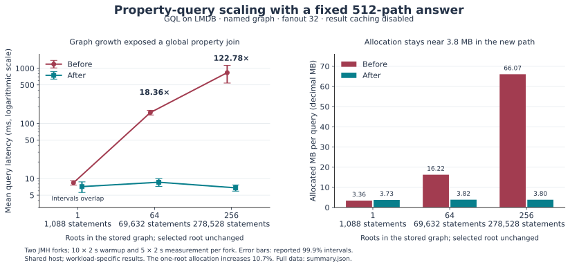

# GQL/LMDB execution performance, 9 November 2026

This change substantially improves selective scalar-property queries on the existing RDF-backed GQL implementation. With a fixed answer of 512 paths and fanout 32, named-graph evaluation falls from **157.47 ms to 8.58 ms at 64 roots**, and from **833.61 ms to 6.79 ms at 256 roots**. The paired means improve by **18.36×** and **122.78×**, respectively. A merged-graph variant at 64 roots improves from **158.51 ms to 6.02 ms**, or **26.31×**. These are workload-specific measurements on a shared machine; they are not a universal GQL speedup or a conformance claim.

The production baseline is commit `dd1be8b6200afeb755c4278a5a542ac59cbff6ff`. Both executable artifacts use the same expanded benchmark harness. The final implementation and evidence are contained in the commit introducing this report. [Artifact verification](artifact-verification.json) records the executable identities and harness comparison; [validation](VALIDATION.md) records the 698 passing selected regression invocations.

## Measured results

All numbers below use the warmed, two-fork comparison. Latency is mean ± JMH's reported **99.9% confidence-interval half-width**, in milliseconds per operation. Each operation executes the complete query, consumes its scalar result, checks the expected answer, and closes it. A ratio divides the measured means and does not have a separately estimated confidence interval.

| Property-filter fixture | RDF statements | Before ms/op | After ms/op | Before / after |
| --- | ---: | ---: | ---: | ---: |
| Named graph, 1 root | 1,088 | 8.384 ± 0.786 | 7.153 ± 1.560 | 1.17×; intervals overlap |
| Named graph, 64 roots | 69,632 | 157.475 ± 15.116 | 8.579 ± 1.385 | 18.36× |
| Named graph, 256 roots | 278,528 | 833.614 ± 293.000 | 6.789 ± 0.869 | 122.78× |
| Merged graph, 64 roots | 69,632 | 158.509 ± 17.078 | 6.024 ± 1.072 | 26.31× |
| Named graph, 64 roots, prepare + evaluate | 69,632 | 162.199 ± 26.347 | 6.741 ± 1.321 | 24.06× |

The three named-graph fixtures return the same 512 paths. Increasing the root count adds other owners and their properties. The final means stay between approximately 7 and 9 ms in these fixtures, while baseline time grows substantially. The 256-root baseline has a wide interval and relatively few operations per measurement iteration; the large separation remains visible in the raw measurements. The small one-root case does **not** establish a latency improvement because its intervals overlap.

Allocation changes are also size-dependent. At 64 roots, the named property query falls from **16.216 MB to 3.822 MB per operation**, a **76.4% reduction**. At 256 roots it falls from **66.070 MB to 3.798 MB**, a **94.3% reduction**. The one-root case rises from **3.364 MB to 3.725 MB**, a **10.7% increase**. The new per-row lookup has a small fixed-work tradeoff, and the report retains that result. MB denotes 1,000,000 bytes; JMH's `gc.alloc.rate.norm` measures allocation, not retained heap or peak memory.

The complete ten-case matrix also includes named and merged topology, higher fanout, labels, NEXT/UNION, and preparation plus evaluation. See [RESULTS.md](RESULTS.md) for every mean, interval, allocation result, expected count, and normalized adjacency counter. The [raw JMH results and full logs](results/) preserve all forks and iterations. [summary.json](summary.json) is the machine-readable summary. Control cases with overlapping intervals are treated as inconclusive even when one mean is lower.

Published text exports normalize trailing whitespace and final newlines for repository formatting. JSON values, raw iteration measurements, test outcomes and log content are otherwise preserved.

Merged topology is 1.846 ± 0.225 ms before and 1.799 ± 0.241 ms after; NEXT/UNION is 8.953 ± 2.271 ms before and 9.065 ± 4.684 ms after. The named topology control has a higher after mean, 2.443 ± 1.840 ms versus 1.741 ± 0.134 ms, with wide overlapping intervals. None of the topology, label or NEXT/UNION controls establishes a latency improvement or a reliable regression. Their individual results remain in the complete matrix. Preparation and prepared-evaluation cases are independent trials; subtracting their means would not isolate parser cost.



The figure plots the three prepared named-graph property cases. [plot-results.py](plot-results.py) regenerates its SVG and PNG from `summary.json` using matplotlib.

## What changed

### Scalar properties now follow the bound owner

The previous compiler lowered a property access into a graph-wide grouped property relation: `COUNT(DISTINCT value)` and `SAMPLE(value)`, attached through a left join. The native physical plan could materialize the property groups and compare them repeatedly with path rows. In the 64-root fixture, 2,048 property owners and 1,024 input paths expose 2,097,152 potential group/path compatibility candidates. That count is derived from the fixture and plan; it is not an instrumented event count. The baseline profile identifies lazy RDF value resolution and lexical join-key matching as prominent costs.

The compiler now attaches an eager `GqlScalarProperty` value operator with an explicit owner expression and private subject/value slots. The evaluator reads only that owner's statements through the existing source, graph selection, dataset, indexes, and snapshot. It retains the first literal, ignores nonliteral objects, compares subsequent literals by exact RDF-term equality, and fails immediately on a second distinct literal. Its distinct-value accumulator uses constant space. Duplicate copies of the same literal across RDF contexts count as one value.

An absent or nonresource owner opens no property cursor. A property with no literal value becomes null under the existing GQL expression contract. Multiple distinct literal values remain a fatal query error. Eager placement and optimizer safety annotations preserve that validation through CASE, COALESCE, unused LET values, and later filters. The cursor is closed on completion, error, and cancellation; duplicate or nonliteral streams still poll interruption and replay cancellation.

The LMDB strategy prepares the property's child through its existing `genericOnlyView()`. This selects the indexed statement evaluator for the small owner lookup, including the child of a graph-selection filter. The enclosing query can still use native traversal. This dispatch detail matters: the initial prototype entered a complete native tuple evaluation for each owner lookup, making the small property case slower. Its retained measurements led to this correction before the final comparison. The production code contains no property-result memo, and a retained prepared value step continues to read fresh source values on subsequent evaluations.

The operator runs per input path row; the implementation does not yet batch or memoize repeated owners. The result above establishes removal of the expensive global property join for these cases, not an optimal implementation of every property workload.

### Proven-unique LMDB statements can stay in one native join

The merged RDF view needs to deduplicate the same subject/predicate/object edge when it occurs in multiple contexts. The compiler retains that algebraic DISTINCT. A canonical, pinned LMDB source can now prove that its physical statement plane already contains unique triples when its transaction-local live context catalog has at most one entry. The planner then omits the redundant physical `RowDistinctPlan`, allowing adjacent statement patterns to flatten into the native join.

The proof concerns the source's live contexts, not simply a query selecting one graph. Multiple contexts, multiple active statement planes, mutable overlays, unknown sources, invalid snapshots, and noncanonical physical IDs retain the conservative path. Synthetic value wrappers delegate the narrow statement proof while the physical source is checked for canonical statement IDs. The original algebra remains intact so each new evaluation or replay obtains a proof for its own source. Generated kernel classes bind the current plan; a previously compiled class does not preserve an old snapshot's uniqueness decision.

The [final untimed merged topology diagnostic](plans/final-plan-gql-merged-topology.log) shows the native join and verifies 1,024 paths. Its single verified evaluation records 18 adjacency lookups and four kernel views, compared with 36 lookups and no kernel views in the corresponding baseline diagnostic. The warmed comparison's aggregate counters are reported separately in [RESULTS.md](RESULTS.md). Its latency intervals overlap, so native-kernel admission alone is not reported as an established latency speedup.

## Method and scope

The benchmark is [GqlAdjacencyQueryBenchmark.java](../../../../sail/lmdb/src/test/java/org/eclipse/rdf4j/sail/lmdb/benchmark/GqlAdjacencyQueryBenchmark.java). Its fixtures have private middle nodes per root and shared leaves. The selected root is always the first root. Two-hop topology returns `fanout²` paths; PROPERTY_FILTER accepts the upper half of integer middle-node scores; NEXT_UNION returns both branch bags. LABEL labels all relevant nodes, so it measures label-check overhead with a 100% match rate, not selective label pruning. Shared leaves acquire higher incoming degree as roots are added; the fixture is not a proof that all graph-degree distributions scale identically.

The comparison fixes `language=GQL`, `adjacency=PREFER`, and `nativeEvaluation=true`. NAMED selects the single stored named context explicitly. MERGED uses the merged RDF view of that same one-context fixture. Both modes therefore contain identical data. Repeated triples across multiple contexts, transaction overlays, and changing graph parameters are covered by regression tests, not by these timing fixtures.

The environment is Linux x86_64 on an AMD EPYC 7763 host, with nine visible logical CPUs, OpenJDK 25.0.5+8, and JMH 1.37. Each trial uses one benchmark thread, `-Xms512m -Xmx2g`, **10 warmup iterations of 2 seconds**, **5 measurement iterations of 2 seconds**, **2 independent forks**, and the JMH GC profiler. Before/after order alternates by case. Fixture loading and adjacency construction happen outside timing. Query result caching and inferred statements are disabled. No Maven build or competing task benchmark ran concurrently. The shared host is not isolated hardware and CPU quotas were not exposed; see [environment.json](environment.json).

`countPaths` reuses a prepared query but includes normal runtime optimization, plan creation, execution, consumption, and closing. `prepareAndCountPaths` additionally includes parsing/preparation and parameter binding. The common result assertion remains inside timing in both artifacts. Every invocation checks its independently computed answer; a result-count mismatch fails the trial.

Engagement counters span warmup plus measurement and exclude initial setup diagnostics. They are normalized by the matching number of evaluations. More or fewer lookups alone do not determine performance. JFR was used separately to identify hotspots through the repository's supported profiling helper; those unwarmed, instrumented times are excluded from the comparison. [PROFILE.md](PROFILE.md) distinguishes leaf samples, overlapping inclusive samples, allocation samples, plan reasoning, and reference-implementation ideas.

These results do not cover cold storage, concurrent writes, large property payloads, arbitrary skew, shortest/unbounded paths, native property-graph storage, or all GQL constructs. The fixed-result property scale series, independent controls, and regression matrix establish this change's observed benefit and semantic boundaries. Full ISO GQL implementation and normative conformance review remain unfinished.

## Reproduction

Use Java 25 and the repository's workspace Maven cache. Create a baseline worktree at `dd1be8b6200afeb755c4278a5a542ac59cbff6ff`. Copy the **final benchmark Java file only** from this change into that worktree so the fixtures, assertions, and measurements match. Build prerequisite modules and executable benchmark artifacts in each worktree, one at a time:

```sh
mvn -B -ntp -o -Dmaven.repo.local=.m2_repo -Pquick install
mvn -B -ntp -o -Dmaven.repo.local=.m2_repo -pl core/sail/lmdb -Pquick,benchmarks install
```

Preserve each worktree's `core/sail/lmdb/target/jmh-benchmarks.jar` under a distinct filename before changing source or rebuilding. If the offline cache lacks dependencies, obtain them once through the normal repository build process. The executable JAR hashes from this run are recorded in [baseline-artifact.json](baseline-artifact.json) and [final-artifact.json](final-artifact.json); independent builds may differ in archive metadata. Artifact verification also compares the harness's `javap -p -c` listings so formatter line-number changes are not mistaken for benchmark behavior changes.

From this report's final checkout, run:

```sh
python core/queryparser/gql/benchmarks/2026-11-09-performance/run-comparison.py \
  --before-jar /absolute/path/before-jmh.jar \
  --after-jar /absolute/path/after-jmh.jar \
  --jdk /absolute/path/jdk-25 \
  --output /absolute/path/new-comparison-directory
```

The driver invokes `scripts/run-single-benchmark.sh --no-build`, pins every parameter, records commands and artifact hashes, and restores the original target JAR in `finally`. The output directory must be new. It uses a task-specific Java temporary directory for JMH's normal lock; it does not ignore the lock. Run one driver at a time and do not build the benchmark module concurrently. `--case` can select individual cases. The complete parameter product of the Java harness is broad, so unpinned direct JMH invocations are not equivalent to this report.

Regenerate and validate the result tables with:

```sh
python core/queryparser/gql/benchmarks/2026-11-09-performance/summarize-results.py \
  --input /absolute/path/new-comparison-directory \
  --output /absolute/path/new-summary-directory
```

The summarizer verifies all ten successful pairs, matching parameters and methods, fork/iteration counts, metric units, and per-fork adjacency counters. The summary and result tables for the bundled raw data can be regenerated by omitting its arguments. Validation commands, preserved failing reports, matched pre/post passing evidence for the final dispatch change, and the corrected snapshot-fixture explanation are in [VALIDATION.md](VALIDATION.md).
