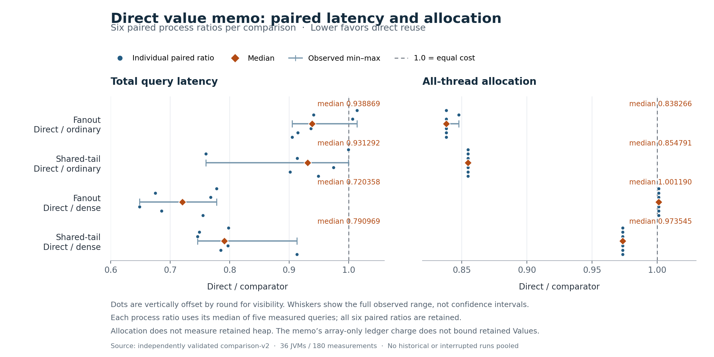

# Direct lazy Value memo: completed matched experiment

Date: 2026-11-16. Branch: `GH-0000-lmdb-lazy-result-coordinates`.

## Decision

The requested iteration-wide direct map is worth pursuing as an off-by-default experiment. Against ordinary weak reuse, its median paired query latency fell by **6.1% on fanout and 6.9% on shared-tail**, while allocation fell by **16.2% and 14.5%**. The latency improvement was not uniform: two of six fanout pairs were slightly slower. Against dense coordinate reuse, direct-map latency fell by **28.0% and 20.9%**, with every pair faster, although fanout allocation rose by **0.119%**. Both unchanged engineering screens therefore failed.

The coordinate comparison is now concrete under identical ownership code. Enabling the dense strategy increased median paired total latency by **32.2% on fanout and 18.6% on shared-tail** compared with ordinary reuse; all six pairs were slower on each fixture. Dense reuse made fewer source calls, but those savings did not produce a faster query on these workloads. This establishes a net strategy tradeoff, not an isolated measurement of coordinate-copy CPU cycles.

Keep the direct map experimental. Its array reservation does not account for retained wrappers, later-decoded payloads, or identity/owner graphs, and its permanent first-window cutoff remains unchanged. The next useful experiment is a matched retention comparison with payload and consumer-lifetime boundaries, followed separately by a delayed-repetition admission experiment. Another coordinate micro-optimization is a lower priority until it can beat the ordinary and direct controls on complete query cost.

Primary evidence: [independent analysis](independent-v2/independent-report.md), [all independent observations](independent-v2/independent-results.json), and [driver reconciliation](review/comparison-v2-reconciliation.md). No historical, qualification, diagnostic, or interrupted-cohort measurements enter the estimates below.

## What was implemented

The prototype shares one strong, direct-mapped table across projected columns and rows of a native result iteration. Its full key is `(value ID, complete position mask)`. It caches lazy `Value` objects, not rows or factorization coordinates. A miss calls the ordinary lazy-value path without explicitly initializing the result. A valid hit returns the same object, including any resolution a previous consumer caused. Collisions replace one slot directly; there is no probing or LRU chain.

The existing outward-row owner is `NativeResultMaterializer`, which already controls the source, result view, exposure scope, accepted-row capture and cleanup. The experiment places the memo there. `AggContext` handles internal evaluation in this implementation and would not intercept the outward lazy-value path used by these queries. This placement preserves the requested iteration lifetime and cross-column sharing without changing the ownership migration. A replay gets a new owner and memo; detached binding sets drop their memo/source references.

The feature is disabled by default through `rdf4j.lmdb.nativeValueMemo.enabled`. The measured direct arm also explicitly sets `rdf4j.lmdb.resultCoordinateTransport=off`; disabling transport removes producer work as well as making coordinates unused by the memo. Stable IDs, source/view identity, exposure validation, full-mask equality and mutation checks remain required. Unsupported sources fall back to ordinary lazy resolution. The direct arm bypasses the existing ordinary and factor caches so its probe population implements the proposed policy.

Misses are published immediately after lazy resolution, rather than at the end of row capture. This matters when values in the same row collide: deferring publication would change which later access can hit and which key is evicted. Both individual value access and projected-value collection use the memo. Individual access has no explicit Sail exposure token, so a candidate whose native value is still internally owned must still pass through ordinary lookup to establish the ownership handoff. Candidate-hit statistics are consequently not a universal count of source calls avoided; raw source-call counters remain authoritative.

### One necessary strengthening: the identity witness

The timed implementation has **five arrays**, rather than the four in the proposal. The extra array retains `LmdbValue.InternalIdentity` witnesses. A built-in value can change its dictionary ID or revision through `setInternalID` without changing its semantic version. A hit therefore verifies the semantic version, dictionary ID, revision number and revision owner. An equivalent identity replacement during normal lazy initialization remains valid.

A separately compiled four-array variant failed exactly three intended invalidation assertions: changed internal ID, changed revision number and changed revision owner. The strengthened candidate passes those same cases. These are controlled correctness counterexamples, not observed wrong checksums in the timing study. The four-array variant is diagnostic only and never entered the accepted timing cohort. See [counterexample evidence](contracts/validation/identity-counterexample-v1/) and [passing table contracts](contracts/validation/green-v1/).

### Adaptation and charging

The first probe allocates 4,096 slots. At probe 8,192 the memo permanently disables if cumulative hits are below 25%; it does not grow at that first boundary. At later multiples of 8,192 it may double when cumulative hits are at least 25% and cumulative collisions at least 12.5%, up to 65,536 slots. A refused initial or growth reservation disables the memo and releases its arrays. Scope clearing removes entries without restarting the iteration's cumulative history.

The array estimate is `80 + 36 × capacity` bytes, using a 16-byte header per array and an eight-byte reference estimate. This charges 147,536 bytes initially and 2,359,376 bytes at maximum capacity. Reserving a replacement before releasing the old arrays produces a maximum array growth peak of 3,539,104 bytes. Projections wider than 64 columns reserve their additional scratch separately. These are explicit ledger estimates, not measurements of the total retained heap.

With the fixed hash and exact power-of-two doubling, occupied old buckets rehash injectively: each old bucket maps either to its previous index or that index plus the old capacity. Distinct occupied old buckets cannot collide during that rehash. The defensive rehash-discard counter is therefore required to remain zero for this implementation.

## Matched experiment

All three arms use the same compiled experimental prefix, common ownership runtime, source/exposure checks, fixture, query, JVM options and normal AUTO selection. Only the memo and transport properties differ.

| Arm | Direct memo | Transport | Existing result reuse |
|---|---|---|---|
| Ordinary | Off | Off | Ordinary weak last-value reuse |
| Dense | Off | Dense | Ordinary weak reuse plus dense factor pages |
| Direct | On | Off | Shared strong direct map; ordinary/factor reuse bypassed |

The ordinary control is already a reuse implementation, not an uncached baseline. The new direct/ordinary allocation reduction should not be compared directly with the earlier approximately halved allocation from other runtime snapshots.

The completed cohort contains **36 fresh JVMs**: three arms, two fixtures and all six arm-order permutations. Each JVM runs eight warmups and five measurements, giving **468 queries: 288 warmups and 180 measurements**. Fixture order alternates by round. The runtime is Java 25.0.5+8 with `-Xms1024m -Xmx1024m -XX:+UseG1GC`, a 512 MiB query ledger and a 1 GiB global ledger. No forced GC, forced strategy, extra warmup, replacement run or timing-based exclusion was used. Builds, tests, profiling, compression and heavy audits stayed outside the timing sequence.

| Fixture | Input shape | Projection | Result rows/query | Checksum |
|---|---|---:|---:|---|
| Fanout | 100 measurements, 10 readings, two statuses, no unique payloads | 12 | 1,152,000 | `3123987218479850048` |
| Shared-tail | 64 roots, 128 left and 128 right members, tuple width two | 6 | 1,048,576 | `8327963502356915200` |

Every query was fully consumed. Shared-tail additionally passed an independent exact-bag oracle for tuple associations and multiplicities. All 180 measurements used normal AUTO row/join dispatch to compiled `irKernel`. Warmups contained 252 compiled and 36 interpreted binds. All native-root audits, active-adjacency observations and final query-ledger endpoints passed. All 312 same-round treatment-query pairs matched their route and adjacency observations. See the [frozen protocol](benchmark/frozen-protocol-v1.json) and [reconciliation](review/comparison-v2-reconciliation.md).

Each JVM contributes the median of its five measured queries. Each reported ratio divides same-round JVM medians within one fixture. The estimator is the median of those six ratios, and ranges include all six. It is not a ratio of pooled query samples or of the absolute table entries below. Six paired processes provide bounded engineering evidence, not a population confidence interval.

## Latency and allocation

Ratios below one favor the first arm. Allocation is total bytes allocated by all observed threads during the original query window.



The [scalable figure](artifacts/direct-memo-paired-ratios.svg), [plotting source](artifacts/plot-paired-ratios.py) and [exact plotted values](artifacts/direct-memo-paired-ratios.json) are preserved. Whiskers show full observed ranges, not confidence intervals.

| Fixture | Comparison | Latency ratio, median [range] | Allocation ratio, median [range] |
|---|---|---:|---:|
| Fanout | Direct / ordinary | **0.938869 [0.904949, 1.014191]** | **0.838266 [0.838224, 0.847811]** |
| Shared-tail | Direct / ordinary | **0.931292 [0.759988, 0.999835]** | **0.854791 [0.854773, 0.854795]** |
| Fanout | Direct / dense | **0.720358 [0.648404, 0.778009]** | **1.001190 [1.001131, 1.001209]** |
| Shared-tail | Direct / dense | **0.790969 [0.746203, 0.913119]** | **0.973545 [0.973511, 0.973575]** |
| Fanout | Dense / ordinary | **1.322319 [1.198384, 1.444655]** | **0.837269 [0.837216, 0.846853]** |
| Shared-tail | Dense / ordinary | **1.185796 [1.014839, 1.252892]** | **0.878018 [0.877996, 0.878032]** |

Every primary latency ratio remains visible:

| Fixture | Comparison | Round 1 | Round 2 | Round 3 | Round 4 | Round 5 | Round 6 |
|---|---|---:|---:|---:|---:|---:|---:|
| Fanout | Direct / ordinary | 0.904949 | 0.914644 | 0.936720 | **1.006659** | 0.941018 | **1.014191** |
| Shared-tail | Direct / ordinary | 0.948967 | 0.901512 | 0.974784 | 0.913617 | 0.759988 | 0.999835 |
| Fanout | Direct / dense | 0.755141 | 0.685576 | 0.648404 | 0.768142 | 0.674819 | 0.778009 |
| Shared-tail | Direct / dense | 0.913119 | 0.785076 | 0.796861 | 0.746203 | 0.748876 | 0.798022 |

The prospectively fixed screen requires, on both fixtures, median latency at most 0.95, every latency pair below one, median allocation at most one, and every allocation pair at most 1.02. The direct/ordinary screen fails only the two fanout latency pairs. The direct/dense screen fails only the fanout median allocation criterion. The small size of these misses is useful context but does not justify changing a threshold after observing the data. These screens are neither significance tests nor production-promotion rules.

## Absolute cost and preparation

These are medians of the six JVM medians. Allocation uses decimal GB. Ledger peaks use MiB and measure charged bytes, not total retained memory.

| Fixture | Arm | Total seconds | Allocation GB | Preparation ms | Evaluation ms | Ledger peak MiB |
|---|---|---:|---:|---:|---:|---:|
| Fanout | Ordinary | 2.399233 | 1.630341 | 1.764441 | 15.216631 | 0.002319 |
| Fanout | Dense | 3.172454 | 1.365037 | 1.891369 | 15.476674 | 2.160042 |
| Fanout | Direct | 2.273520 | 1.366661 | 1.826935 | 16.555244 | 0.140701 |
| Shared-tail | Ordinary | 1.633235 | 1.320700 | 1.081096 | 5.240205 | 0.001404 |
| Shared-tail | Dense | 1.881426 | 1.159598 | 1.015421 | 4.978070 | 260.303745 |
| Shared-tail | Direct | 1.482211 | 1.128922 | 1.065982 | 4.918110 | 0.140701 |

The absolute medians of individual phases need not sum to the median total. Most observed query time is consumption: fanout consumption medians are 2.377, 3.155 and 2.255 seconds for ordinary, dense and direct; shared-tail medians are 1.627, 1.876 and 1.475 seconds. First-row and close timings are retained in the independent JSON. Close medians are approximately 0.11–0.15 ms. Warm preparation does not explain the total-latency differences; it stays around 1–2 ms and has no consistent direct-map improvement.

The first query is separately reported after fixture construction. It excludes JVM launch and fixture setup, and does not enter the warm-latency screen.

| Fixture | Arm | First-query seconds | First-query preparation ms |
|---|---|---:|---:|
| Fanout | Ordinary | 4.801314 | 65.387065 |
| Fanout | Dense | 7.404039 | 69.058893 |
| Fanout | Direct | 4.061346 | 58.564283 |
| Shared-tail | Ordinary | 3.298350 | 58.191180 |
| Shared-tail | Dense | 3.758951 | 67.669901 |
| Shared-tail | Direct | 3.013617 | 60.920032 |

Cold preparation is variable; for example, shared-tail direct/ordinary paired preparation ratios range from 0.837827 to 3.138335. No general preparation-speed claim follows from this small cohort. All warmups remain preserved.

## What the memo actually did

Every direct query, including warmups, followed the same table pattern within its fixture:

| Per-query observation | Fanout | Shared-tail |
|---|---:|---:|
| Direct probes | 13,824,000 | 6,291,456 |
| Validated candidate hits | 13,790,614 | 6,119,366 |
| Candidate hit rate | 99.7585% | 97.2647% |
| Occupied different-key probes | 32,405 | 167,994 |
| Direct source calls | 33,386 | 172,090 |
| Ordinary source calls | 2,770,101 | 2,113,601 |
| Dense source calls | 1,147 | 32,833 |
| Entries immediately before close | 981 | 4,096 |
| Table capacity | 4,096 | 4,096 |
| Peak charged array bytes | 147,536 | 147,536 |
| Charged array bytes after close | 0 | 0 |

There were no resizes, low-hit disables, scope clears, invalidations, unsupported admissions, rehash discards or admission refusals in this cohort. All 156 direct owners align with their query's native-compile ordinal and cumulative source-call interval. Control arms created no direct owners. On these fixtures, direct misses equal source calls; that equality is not a general API guarantee for standalone accesses.

The table therefore showed cross-row and cross-column reuse without requiring growth. It did not demonstrate the effectiveness of the adaptive thresholds. High candidate-hit rates also do not imply one decode per unique ID. Collisions and repeated misses remain visible, and `lazyValue` calls measure source lookup/wrapper work rather than actual lexical decodes.

The lower source-call count of dense reuse is particularly informative: it still takes longer than either ordinary or direct reuse. The direct strategy changes table organization, strong retention, lookup work and coordinate usage together. The results cannot attribute a particular number of milliseconds to any one of those mechanisms.

## Correctness and limits

The candidate passed **146 fresh test executions** with zero failures, errors or skips: 20 table contracts, 12 integration contracts, 106 selected existing cases with the memo disabled, and eight enabled-feature lifetime/bag cases covering both interpreted and compiled IR. Test-first intentional-red evidence is preserved. The separate semantic-version-only diagnostic failed its three intended assertions and is not a qualified candidate. A six-JVM full-size lifecycle qualification passed another 78 queries before the primary protocol was frozen; its timing data were never pooled with the study.

LMDB compiled successfully, and its 2,778 production classes matched the preserved common runtime. The full root reactor remained blocked by an uncached Kotlin dependency in unrelated Spring modules and Maven Central DNS failure. This report does not claim a green full-repository build or an exhaustive new repository test run. Fresh candidate evidence is in [contracts](contracts/VALIDATION.md), [focused validation](validation/), and [lifecycle audit](review/qualification-audit.md).

The largest unresolved issue is retention. Strong entries can retain wrappers and payloads initialized after admission. Identity witnesses can also retain revision/owner graphs. The arrays are bounded, but the graph behind one slot need not be. A lower allocation total measures less allocation churn, not a retained-heap guarantee. The direct ledger peak of 147,536 bytes therefore cannot be compared with dense's ledger as a complete memory-footprint comparison.

A fixed table size is insufficient when lexical payload size varies. Inspecting the size only on the next hit would not provide a hard bound either: the object may grow when a different consumer resolves it, before that next hit exists. Production accounting needs a pre-growth reservation/ownership mechanism, bounded immutable entries, or a retention policy that does not keep those payloads alive. Any weak-table experiment must also examine the identity-witness references rather than weakening only `Value[]` and assuming retention disappears.

The one-time cutoff is the other deliberate limitation. A workload with a unique prefix followed by a highly repetitive suffix can permanently disable the cache before its useful phase. The correctness contracts characterize this behavior; the primary fixtures never encounter it. Growth, delayed reuse, long payloads, early close, retained rows, high uniqueness, wide projections and constrained memory have not been performance-qualified by this study.

## Next experiment worth running

First compare ordinary reuse, the current strong direct map and a weak direct map with identical keys, witnesses, source/exposure fences, replacement order and startup policy. Keep coordinate transport off. Vary payload length and when lazy values become decoded, then cross full consumption, early close and retained-row lifetimes. Separate normal timing runs from heap-attribution diagnostics. Attribute the graphs retained through both value and identity arrays, distinguish shared source ownership from exclusive memo retention, and examine states before initialization, after initialization, after scope clear and after close. A heap dump or forced collection used for attribution must not enter the latency cohort.

The decision is whether a bounded retention design keeps enough of the current latency/allocation benefit under realistic payload and lifetime pressure. Reserve-before-growth behavior and correct results after admission refusal are acceptance conditions; the existing array total is not a substitute. A weak direct map is a mechanism experiment, not a presumption that weakening references is the production solution.

Then keep the chosen retention policy fixed and compare permanent cutoff with bounded reconsideration. Use streams whose first repetition falls just before, at and beyond probe 8,192, plus all-unique controls; keep the final multiset comparable while changing order. Report disabled-time overhead, time to recover useful reuse, allocation, results and budget compliance. This separates the retention question from the admission-policy question instead of changing both in one treatment.

The design review also consulted PostgreSQL's primary implementation. Its [memoize cost model](https://doxygen.postgresql.org/costsize_8c_source.html) explicitly accounts for lookup, entry creation and eviction, and its [executor](https://doxygen.postgresql.org/nodeMemoize_8c_source.html) can bypass caching when a scan exceeds available cache memory and reconsider on a later rescan. These are useful design comparisons, not claims that its row-oriented LRU cache should replace this lazy-value direct map. No PostgreSQL code or new dependency was imported.

## Provenance, interrupted attempt and deliverables

The first primary controller disappeared after seven complete JVMs and four warmups of the eighth. The cause remains undetermined: the evidence does not establish a timeout or OOM. Its entire directory is preserved under `comparison-v1`, and it contributes no accepted estimate. The replacement `comparison-v2` uses a separate prospective supervisor with the same protocol, runtime, exact 36 Java commands and analysis rules. Each invocation launches one JVM, validates it and exits. Root observed all 36 terminal tool exits as zero before advancing. Missing or partial receipts block further execution; no slot was retried or replaced.

The independent analyzer imports no experiment driver and reads no driver estimate files. It revalidated all raw results and exactly reconciled all 324 paired metric ratios, 324 per-JVM metric medians, all summary medians/ranges and all 18 screen gates. A separate receipt audit verified the 36 claim/completion links and 252 per-slot raw-file hashes. The full post-run runtime-preservation check passed. Inter-JVM gaps are recorded and no old cohort is pooled.

| Identity | SHA-256 |
|---|---|
| Frozen protocol | `8140db1dafa30ff1121e56284837b52b7a395464f656a7f3eecf9eea8f0fcc84` |
| Qualified runtime descriptor | `cf4336e8ce853bc3f4a604f0f29b4e3c9acfcff4751ea0b028c78e71f98d8115` |
| Finite supervision manifest | `5a66f04e0618acbf6c36d2941b1a10858197feb6ed289fe867c2d4c431564e07` |
| Independent result JSON | `ba79dee70320b9e11d1aba149311702ab898e2c95acf8d32c7b75b8badfeacd5` |
| Complete source archive v2 | `ec478c591ac19f93f8fdeebdc224777b8a8283a7719e57de597c19084ea76b8e` |
| Four-file implementation patch | `9109010da8d0dadde1c2fc7a8a29658ecf4d8226790e92ea86443a8a2332c797` |

The validated implementation was checkpointed on HASMAC as `678292b6538f24d8982ec35bca8ba404a6797d5b`. Full-size qualification, the complete original source package and the interrupted first attempt were checkpointed as `591b70e10eaf2d01d0735064a3993d401f17a03e` before the fresh cohort. Final publication receipts are kept under this phase's `recovery` directory.

The selected production checkout was not replaced during measurement. The implementation is supplied as a verified patch and complete source package, and the exact experimental prefix is preserved separately. The [source archive v2](artifacts/direct-memo-complete-source-v2.tar.gz) contains all four production files in full, both new test classes, generators, contract runners, benchmark/analyzer code, frozen supervision files and [reproduction instructions](artifacts/REPRODUCTION-v2.md). All 38 archive members were read back and verified; all 33 original members remain byte-identical. Applying the [four-file patch](artifacts/direct-memo-source.patch) in an isolated checkout reproduced the compiled candidate source bytes exactly. The [six-class prefix](artifacts/identity-witness-v2-prefix.tar.gz) requires the preserved common runtime; it is not a standalone RDF4J distribution.

Three verbose JSON files are preserved in Git as deterministic, lossless gzip copies: the complete independent result, assembled driver runs and finite supervision manifest. Their original files remain available locally without modification. The [preservation manifest](recovery/preserved-comparison-v2-json/manifest.json) records both raw and compressed sizes and hashes. After cloning, restore their exact original paths from the repository root before replaying the completed cohort's audits:

```bash
python3 -B result-coordinate-evidence/direct-memo-followup/recovery/preserved-comparison-v2-json/restore.py --restore
```

The helper verifies equal existing files and refuses to overwrite differing ones. It restores no Java runtime or dependency corpus; those remain the separate prerequisites documented in the reproduction guide. Individual JVM observations, readable reports, the complete implementation patch and the source archive remain directly available in the checkpoint.
