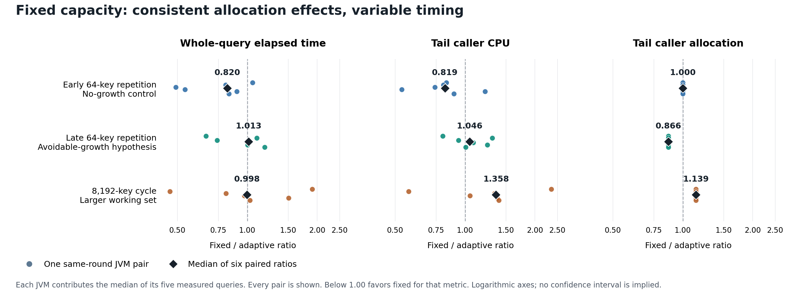

# LMDB native Value memo: fixed capacity versus adaptive growth

Completed 17 November 2026. Accepted performance cohort: **comparison-v2**. The memo remains experimental and disabled by default.

## Decision

**Fixed capacity removes unnecessary memory reservation and array allocation in the late-repetition fixture, but this experiment does not establish a latency improvement.** Keeping 4,096 slots preserves all 98,240 hits and 32,832 lazy source calls per query, removes four resizes, and lowers the peak tracked memo reservation from 14,549,472 to 606,448 bytes. Tail caller allocation falls 13.39%. The paired whole-query latency estimate nevertheless rises 1.30%, its mean sensitivity rises 2.60%, and tail caller CPU rises 4.57%. Directions vary between process pairs.

**Fixed capacity also loses useful reuse when the working set exceeds its capacity.** On the 8,192-key cyclic tail, source calls rise from 32,566 to 107,656 per query. Tail caller CPU rises 35.82% and tail caller allocation rises 13.92% in the prespecified paired estimates. Whole-query latency is near unity, with very wide process-pair variation, so it does not faithfully summarize this tail cost by itself.

The equal-event early-repetition control prevents a simple attribution of elapsed-time differences to resizing. Neither enabled arm resizes there, yet fixed/adaptive whole-query latency is 0.8197. The two arms select different growth flags, so this is not a pure A/A control; however, its apparent 18.0% advantage cannot result from avoiding resize work that never occurs. The cause of the remaining policy/process variation is unresolved.

Keep the default unchanged. The next performance investigation should diagnose the variation in identical-policy controls and qualify a longer normal-AUTO/compilation history before another end-to-end speed claim. A later, narrowly scoped controller experiment can replace cumulative collision demand with recent-window collision demand while retaining the existing cumulative hit gate and admission behavior.

All **54 accepted JVMs and 702 queries** passed result, route, exposure, ownership and cleanup checks. The independently implemented auditor reproduced the calculations. The complete source and both patches are available below.

## What changed

The implementation adds one constructor-captured option:

```text
rdf4j.lmdb.nativeValueMemo.growth=adaptive|fixed
```

The default is `adaptive`. `fixed` skips the later growth branch and retains the initial 4,096-slot table. It preserves initial allocation and refusal, the independent initial/always admission choice, direct mapping, full `(ID, position mask)` keys, source and semantic identity checks, weak ownership, fallback and close behavior. An unknown option is rejected before the statistics owner opens.

This is an iteration-local Value memo. It shares lazy Values across projected columns and rows without caching entire rows or using factor coordinates. Both enabled comparison arms use the same weak-retention implementation and always admission. The materializer, projected binding set and statistics companions are byte-identical to the preceding admission experiment. Relative to that runtime prefix, only the memo and its nested-class bytecode change. All three arms execute the same current classpath bytes and select behavior through properties.

The implementation is delivered as complete experimental review sources and exact patches. The benchmarks load compiled classpath prefixes ahead of frozen module classes; the new feature sources have not been installed into the repository's ordinary module source tree.

The new harness takes four caller CPU/allocation snapshots: before connection work, after the declared prefix, after consumption, and after explicit close/retained reads. This provides bounded phase measurements without per-row CPU/allocation sampling. It does not add a production dependency.

## Design and controls

Every fixture has **32,768 rows, four projected columns, 131,072 projected opportunities and 64-character IRI payloads**. A hidden unique row key provides deterministic `ORDER BY`. The consumer reads every Value's lexical string and checks a row-position-sensitive checksum. Each process deterministically populates its store, closes it and reopens it with default source caches.

| Fixture | Prefix opportunities | Tail opportunities | Tail keys | Purpose |
| --- | ---: | ---: | ---: | --- |
| early-cold-hot | 4,096 unique | 126,976 | 64 | Equal-event control; neither policy grows |
| late-cold-hot | 32,768 unique | 98,304 | 64 | Test growth caused by stale cumulative collision history |
| warm-cycle-8192 | 8,192 cycling over 64 separate bootstrap keys | 122,880 | 8,192 | Test useful growth for a larger working set |

The arms are ordinary access with the memo disabled, adaptive growth, and fixed capacity. All select weak retention, always admission, coordinate transport off, unchanged source caches and normal AUTO. The feature's production default remains disabled.

The runtime is the pinned Temurin 25.0.5+8-LTS, with `-Xms1024m -Xmx1024m`, G1, eight-byte object alignment and compressed object/class pointers. The per-query ledger limit is 512 MiB and the process-authority limit is 1 GiB. Native evaluation and direct adjacency are enabled; direct adjacency remains PREFER. Value overlay and forceSync remain disabled. Indexes are `spoc,ospc,psoc,posc`.

Six rounds use all six arm permutations and balanced fixture orders. Each of the **54 fresh JVMs** runs eight warmups and five measured queries: **432 warmups and 270 measurements**. Every query is validated. No build, test, diagnostic, archive construction or heavy analysis overlaps an accepted timing JVM. Frozen source, classpath, JDK and environment identities are checked before and after each process.

The primary estimator takes the median of five measured queries within each JVM, forms six same-round candidate/comparator ratios, and takes their median. The prespecified sensitivity substitutes each JVM's arithmetic mean of those same five queries. All observations remain included. There is no significance claim, outlier removal or pooling with prior studies.

### Actual execution route

Normal AUTO selected `ORDER / orderedFactorizedSort / normal`, with one native compile, chunk/factorized engagement, zero generic fallback and zero IR execution. Both IR lifetime paths were tested separately; they are not the route measured here.

All nine exact pilots and all 54 accepted JVMs reproduce the same query-ordinal adjacency profile: 98,309 hits for queries 1–8 and 98,308 for queries 9–13, with one planner-statistics hit and no exact miss or adjacency fallback. The source-derived difference is the root scan while the statement-access learner starts sampling its LMDB alternative. **The measured queries cover matched AUTO alternative-source learning, not a demonstrated converged source choice.** No strategy was forced to obtain this profile.

## Fixed versus adaptive: primary results

Ratios below one favor fixed for the indicated metric. Percentages follow the paired estimator, not division of the marginal arm medians.

| Fixture | Whole-query latency | Mean sensitivity | Tail elapsed | Tail caller CPU | Tail caller allocation | Total Java allocation |
| --- | ---: | ---: | ---: | ---: | ---: | ---: |
| early-cold-hot | 0.819682 | 0.795537 | 0.793423 | 0.819152 | 1.000000 | 1.019988 |
| late-cold-hot | 1.012979 | 1.025954 | 1.049416 | 1.045735 | 0.866081 | 0.995654 |
| warm-cycle-8192 | 0.998332 | 0.947475 | 1.358159 | 1.358229 | 1.139152 | 1.014025 |



The figure includes all six process pairs per fixture for each displayed metric. Diamonds are medians of paired ratios, with no confidence interval. The full-resolution [PDF](reports/fixed-adaptive-pairs.pdf), [SVG](reports/fixed-adaptive-pairs.svg) and [plot source](reports/plot_comparison.py) are also retained.

### Late repetition: allocation benefit, no demonstrated speed benefit

Fixed preserves exactly the same source calls, hits, collisions and weak-entry allocations, while eliminating all four resizes. Peak tracked reservation falls **95.83%**. Tail caller allocation is lower in all six pairs, by approximately **3.441 MB per query**, with fixed/adaptive ratios from 0.866032 to 0.866098. The allocation change is much more consistent than the timing change.

The total-latency paired ratios are **0.663444, 1.099493, 0.740786, 1.021212, 1.004745 and 1.186715**. Fixed is faster in two of six pairs. Tail caller CPU is higher in four of six pairs; its ratio range is 0.802418–1.308638. Neither the primary estimate nor its sensitivity supports a late-case speed improvement.

Total Java allocation falls only **0.43%** in the paired estimate. That is a different quantity from the 95.83% reduction in the peak reservation: the latter is an estimated metadata charge including resize overlap, while total allocation includes the rest of the query and allocation outside that memo. These results do not imply a 95.83% reduction in live heap or query memory.

### Larger working set: capacity changes useful reuse

Fixed loses **75,090 hits per query**. Lazy source calls increase **3.305779 times**, from 32,566 to 107,656; collisions increase from 24,857 to 104,128. This is a material capacity tradeoff, not equivalent behavior with a smaller reservation.

Tail allocation is higher in every pair, by approximately 4.83 MB per query. Tail caller CPU is higher in five of six pairs, with a primary ratio of 1.358229; its mean sensitivity is 1.111146. The primary tail elapsed ratio is 1.358159, with mean sensitivity 1.121454. These magnitudes should remain distinct rather than selecting one after observing the data.

Whole-query latency is almost unchanged under the primary estimator, but its six ratios span **0.464733–1.906999**. The complete sequence is **1.906999, 0.464733, 0.809707, 0.970682, 1.508553 and 1.025982**. Three pairs favor each arm. The larger tail cost coexists with substantial variation in the dominant earlier work.

### Early repetition: the attribution control

Both policies make 4,128 source calls, record 126,944 hits and 1,544 collisions, allocate the same initial table, and never resize. Tail caller allocation is identical in four process-median pairs and differs by only 96 bytes in the other two. Their total-latency ratios nevertheless range from **0.492549 to 1.054611**, with a median of 0.819682.

This control does not prove that the policy flag has no cost: the branches differ, and their execution may affect profiling or code generation. It does show that the apparent timing advantage cannot be credited to eliminated resize work. No instruction profile, compilation trace or per-query GC attribution was collected to determine the cause. The report therefore describes observed between-JVM variation without assigning it to GC, JIT, scheduling or an implementation bug.

## Ordinary-access comparisons

These use fresh ordinary controls from the same cohort and identical ownership/runtime code.

| Fixture | Comparison | Whole-query latency | Mean sensitivity | Total Java allocation |
| --- | --- | ---: | ---: | ---: |
| early-cold-hot | adaptive / ordinary | 1.316173 | 1.276840 | 0.960127 |
| early-cold-hot | fixed / ordinary | 0.915258 | 0.966135 | 0.966071 |
| late-cold-hot | adaptive / ordinary | 0.931323 | 0.849472 | 0.992061 |
| late-cold-hot | fixed / ordinary | 0.915578 | 0.890380 | 0.984530 |
| warm-cycle-8192 | adaptive / ordinary | 0.858811 | 0.864861 | 0.981340 |
| warm-cycle-8192 | fixed / ordinary | 0.869390 | 0.843682 | 0.995230 |

No total-latency comparison changes direction under the prespecified mean sensitivity, but no candidate is faster in all six pairs. These descriptive estimates do not establish a general native-query speedup. The earlier 2.79-to-1.42 GB/query results concern other preserved workloads and are not comparable absolute measurements for these fixtures.

## Absolute query measurements

These are medians of six JVM medians. They are not pooled query medians, and dividing two entries does not reproduce the paired estimator. MB is decimal; ledger bytes are accounting claims.

| Fixture | Arm | Total ms | Java allocation MB | Prepare ms | First-row work ms | Tail caller CPU ms | Tracked peak bytes |
| --- | --- | ---: | ---: | ---: | ---: | ---: | ---: |
| early-cold-hot | ordinary | 630.38 | 302.287 | 1.381 | 525.75 | 82.22 | 1,152 |
| early-cold-hot | adaptive | 858.05 | 293.155 | 1.734 | 745.38 | 80.55 | 606,448 |
| early-cold-hot | fixed | 662.68 | 293.367 | 1.437 | 569.96 | 64.10 | 606,448 |
| late-cold-hot | ordinary | 703.12 | 326.932 | 1.346 | 586.82 | 63.79 | 1,152 |
| late-cold-hot | adaptive | 621.59 | 322.892 | 1.207 | 526.67 | 46.06 | 14,549,472 |
| late-cold-hot | fixed | 655.58 | 323.448 | 1.023 | 529.00 | 52.68 | 606,448 |
| warm-cycle-8192 | ordinary | 1,057.24 | 350.844 | 1.556 | 924.43 | 116.46 | 1,152 |
| warm-cycle-8192 | adaptive | 818.91 | 344.298 | 1.364 | 721.63 | 83.91 | 14,549,472 |
| warm-cycle-8192 | fixed | 867.08 | 349.140 | 1.449 | 743.09 | 107.86 | 606,448 |

First-row work is the measured interval after `evaluate()` through the first successful `next()`. The complete preparation/evaluation/consumption/close decomposition, all caller phases and every paired ratio are in [the generated cohort report](comparison-v2/RESULTS.md) and [audit.json](comparison-v2/audit.json).

## Reuse, memory and lifetime observations

The following counts are constant across all 78 queries per fixture/arm, including warmups.

| Fixture | Arm | Hits/query | Lazy source calls/query | Resizes/query | Peak slots | Peak memo reservation bytes |
| --- | --- | ---: | ---: | ---: | ---: | ---: |
| early-cold-hot | adaptive | 126,944 | 4,128 | 0 | 4,096 | 606,448 |
| early-cold-hot | fixed | 126,944 | 4,128 | 0 | 4,096 | 606,448 |
| late-cold-hot | adaptive | 98,240 | 32,832 | 4 | 65,536 | 14,549,472 |
| late-cold-hot | fixed | 98,240 | 32,832 | 0 | 4,096 | 606,448 |
| warm-cycle-8192 | adaptive | 98,506 | 32,566 | 4 | 65,536 | 14,549,472 |
| warm-cycle-8192 | fixed | 23,416 | 107,656 | 0 | 4,096 | 606,448 |

Ordinary access makes 131,072 lazy source calls per query. Lazy source calls are not physical LMDB decode counts. These small payloads are eligible for ordinary source caching, and the ordered wrapper can retain consumed binding sets.

All **468 memo owners opened and closed**, and all **702 ledger endpoints returned to zero**. Collection misses, invalidations, admission refusals, low-hit disables, unsupported-value events and rehash discards were zero. Source calls equal projected materializations throughout. No useful-key weak collection is established by this cohort.

Weak mode avoids a table-owned strong path to Values and their store owner and charges arrays plus conservative reference metadata. The reservation estimate is not total query heap, native memory or a separately exposed active-query peak. The pre-existing strong-retention diagnostic still excludes retained payload graphs; this growth experiment does not repair or promote that incomplete bound.

## Why timing attribution remains limited

The dominant first-row interval precedes the current query's later growth boundaries. `NativeOrderedRowsIteration` builds its ordered rows before `next()` attaches the output materializer; lazy sorted projection does not itself attach that output materializer. The first-row timestamp follows the first returned row, before enough projected probes exist for an 8,192-probe growth boundary. Current-query rehash work therefore cannot explain an earlier first-row difference. The [interpretation review](reviews/INTERPRETATION-REVIEW-v2.md) records the source path and qualifications.

Some component estimates change direction under mean sensitivity even though whole-query estimates do not. Late first-row elapsed changes from 0.976882 to 1.014834; late to-prefix caller CPU changes from 0.999710 to 1.010021. Warm-cycle preparation and evaluation also reverse direction. These observations remain visible and do not replace the declared primary outcome.

Prefix allocation is relatively stable within most five-query process groups but differs between JVMs. Across fixture/arm groups, process-median spans are roughly 9.8–30.4 MB, while typical within-process prefix spans are around 50 KB. This variation is larger than the removed late-case tail allocation. Every cluster remains included; no cause is assigned.

All 702 samples reconcile caller CPU phases, caller allocation phases, total wall intervals and prefix-plus-tail consumption exactly, with zero residual. Separately aggregated medians need not preserve those sums. Caller CPU excludes GC, JIT and other worker threads. The tail includes final exhaustion and automatic cleanup and ends before explicit result/connection close. All-thread allocation ends later, after selection-capture cleanup; subtracting the caller total does not isolate other-thread allocation. Whole-JVM GC logs include population and warmups and cannot assign pauses to an individual measured query.

## Verification and the interrupted first cohort

The smallest new growth contract failed before the implementation change: **one test, one failure, no errors or skips**, expected 4,096 slots but observed 8,192. The full new class then produced exactly seven missing-feature failures and five passing controls. The sealed contract was not edited after that evidence.

The final qualification has **265 passing test executions**: 12 growth contracts, 12 admission contracts, 138 default checks, 47 weak/initial checks, 28 adaptive/always checks and 28 fixed/always checks. It covers both IR lifetime paths and verifies continued fixed-table reuse when no additional reservation is available. Nine fresh full-length exact pilots added **117 lexical-oracle queries**. The final memo bytes are identical to the tested bytes. Every new Java source passes formatting and required headers.

The full root reactor was attempted offline and retried once online as required. Both attempts built and installed LMDB, but failed in unrelated Spring modules because Kotlin 2.3.21 was unavailable; the online retry recorded Maven Central DNS failure. All 2,778 freshly built LMDB classes and both resources match the frozen baseline. This is not a successful full root build. The global header scan also retains four historical findings in frozen old formatting copies; no new source is implicated.

The first frozen growth cohort completed 22 JVMs, then lost its execution-tool handle during slot 23. Four warmup records were saved, but no process or completion receipt. The runner lock was released, and the files remained unchanged beyond the original deadline. **Actual exit status and cause are unknown.** The entire incomplete cohort is permanently rejected; none of its observations enters these comparisons. Automatic per-process summaries from its closed slots remain preserved, but were never inspected or used to choose the fresh experiment.

A non-Java 40-second transport probe completed with a single orchestration cell kept alive through all child waits. The fresh cohort used that supervision. Its protocol is identical apart from 218 path/timestamp scalars; an independent comparison verified that sources, runtime, inputs, schedule and estimators are unchanged. Both the original qualified checkpoint (`7538840c68`) and the fresh-cohort checkpoint (`813c51b9ed`) were published before their respective first timing processes.

The independent final auditor checked all accepted raw seals and reproduced numerical calculations to the prescribed `1e-12` tolerance. See [NUMERICAL-REVIEW-v2.md](reviews/NUMERICAL-REVIEW-v2.md), [its complete numerical detail](reviews/NUMERICAL-REVIEW-v2.json) and [the independent audit](reviews/cohort-independent-audit-v2.json).

## What is worth testing next

First, diagnose the equal-event control with **true identical-policy A/A processes** and a prospectively fixed longer warmup history. Keep normal AUTO and qualify its complete source-selection history. Collect compilation-history evidence in separate diagnostic runs, and distinguish it from host/scheduling and first-row plan work rather than assuming a cause. This should determine whether another end-to-end comparison can resolve the small effect under investigation. Do not force a strategy or remove slow observations to obtain a cleaner result.

Second, test a minimal **recent-window collision gate** while retaining cumulative hits and the existing admission choice. The late fixture's cold prefix leaves a cumulative collision count that continues to trigger growth after the 64-key tail is already reusing successfully. Recent collision demand could avoid that obsolete signal. Retaining cumulative hits matters: a small full table can have a low current hit rate precisely because a larger cyclic set does not fit. Resetting both hit and collision windows can prevent the growth being tested. This proposal needs its own failing contracts and measurements, including the larger-set control and hot-to-unique scans; it is not a validated policy change.

The [TinyLFU paper](https://arxiv.org/abs/1512.00727) studies admission using recent access history, and [Caffeine's official efficiency discussion](https://github.com/ben-manes/caffeine/wiki/Efficiency) describes a recency window combined with frequency estimation. Those are useful design references for separating history and admission. They do not establish that a general-purpose cache or frequency sketch improves this short-lived direct-mapped LMDB memo. No external cache implementation or dependency was introduced.

The broader projection-width, repetition, payload-size and consumption-pattern sweep remains necessary before production selection, especially streaming output, early close, retained rows and constrained memory. This completed experiment isolates growth within full consumption of an ordered result.

## Complete code, patches and recovery

- [Complete source overlay](artifacts/complete-source-v1.tar.gz): 319 regular files, including 48 Java and 54 Python sources; 2,466,704 bytes; SHA-256 `ce87f598e1262540389aa5342bed470d09ca84d3ac80abf50d0a5f8987c2e04e`.
- [Full four-file feature patch](artifacts/complete-native-value-memo.patch), based on `b8d2015ec1b722b71f9a8af9e50cd98558f7882a`.
- [Growth-only patch](artifacts/growth-only-versus-admission.patch), against the preceding admission memo.
- [Source-package/accepted-cohort addendum](artifacts/accepted-cohort-v2.README.md), with exact bindings and restoration commands.
- [Source manifest](artifacts/complete-source-v1.manifest.json), [application verification](artifacts/source-delivery-verification-v1.json) and [coordinator archive readback](artifacts/coordinator-source-readback-v1.json).
- [Accepted protocol](comparison-v2/protocol.json), [full cohort report](comparison-v2/RESULTS.md), [primary audit](comparison-v2/audit.json) and [final route check](comparison-v2/profile-final-v1.json).

Both patches passed strict reconstruction, `git apply --check`, actual application to disposable base files and exact canonical-source comparison. The coordinator read every archive member and matched all four current feature files and both patches. The source archive contains the original historical v1 protocol; its code is unchanged and complete for v2, and the addendum explicitly binds it to the accepted v2 protocol. The report plot's complete source is retained separately under `reports`.

Large source/evidence artifacts are preserved in verified bounded parts with raw and compressed hashes. Fresh restoration, idempotent restoration and refusal to overwrite different bytes were checked before adding exact ignore paths. Original files remain available. All source, reports, raw evidence and rejected-attempt records belong to the `GH-0000-lmdb-lazy-result-coordinates` branch on HASMAC-AS/rdf4j.
